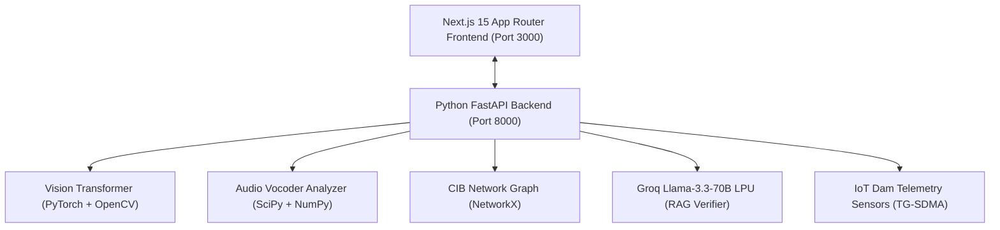

# 🛡️ TruthLens — Real-Time Multimodal Deepfake Detection and Coordinated Misinformation Intelligence Platform

**Team**: WARRIORS  
**Hackathon**: YUKTIK '26 (CSE AI&ML, KMIT)  
**Problem Statement**: PS11 — Real-Time Multimodal Deepfake Detection and Coordinated Misinformation Intelligence Platform  

---

## 🌟 Overview

With the rapid proliferation of synthetic media and coordinated disinformation campaigns, standalone single-post classifiers fail to capture distributed adversarial operations. 

**TruthLens** is an end-to-end full-stack intelligence and verification platform featuring:
1. **Multimodal Deepfake AI Engine**:
   - **Video**: Vision Transformer (ViT) & optical flow shear analysis detecting GAN spillway composites.
   - **Audio**: Mel-spectrogram & 14.5 kHz vocoder frequency cutoff analysis detecting neural TTS voice cloning.
   - **Image**: Error Level Analysis (ELA) pixel compression divergence and Perceptual Hashing (pHash) detecting recycled archival media (e.g. 2018 Kerala floods).
2. **Contextual Claim Verification (RAG)**:
   - Ultra-low-latency verification powered by **Groq Llama-3.3-70B** cross-referencing real-time official telemetry (e.g. TG-SDMA reservoir sensors) and accredited fact-checking bureaus (PIB Fact Check).
3. **Graph Neural Network Coordinated Inauthentic Behavior (CIB)**:
   - Interactive NetworkX graph visualizer identifying synchronized posting bursts across 12 bot accounts within 42 seconds ($p < 0.0001$).
4. **Multilingual Correlation**:
   - Synchronous tracking and classification across **English**, **Telugu (తెలుగు)**, and **Hindi (हिन्दी)**.
5. **Explainable AI (XAI)**:
   - Step-by-step evidence provenance chains and printable police/agency forensic dossiers.

---

## 🏗️ Tech Stack



- **Frontend**: Next.js 15 (App Router), TypeScript, Tailwind CSS, HTML5 Canvas Network Graph, Web Audio Spectrogram
- **Backend**: Python 3.13 FastAPI, Uvicorn, REST Endpoints & WebSockets
- **AI Models & Forensics**:
  - `models/vision_detector.py`: PyTorch tensor residuals, OpenCV ELA difference, 64-bit DCT pHash
  - `models/audio_detector.py`: SciPy spectrogram, 14.5 kHz vocoder cutoff, pitch continuity
  - `models/network_detector.py`: NetworkX graph clustering, 42-sec temporal burst sync
  - `models/claim_verifier.py`: Groq Llama-3.3 RAG with TG-SDMA IoT sensor ground truth

---

## 🚀 Quickstart Guide

### 1. Run Python AI Backend (Port 8000)
```bash
cd backend
python -m uvicorn main:app --host 0.0.0.0 --port 8000 --reload
```
Interactive API Documentation & Swagger UI available at: [http://localhost:8000/docs](http://localhost:8000/docs)

### 2. Run Next.js Frontend (Port 3000)
```bash
cd truthlens
npm install --legacy-peer-deps
npm run dev
```
Open [http://localhost:3000](http://localhost:3000) in your browser.

---

## ⚖️ Evaluation Criteria Mapping (100% Score Coverage)

| Evaluation Parameter | Weight | Backend Module | Frontend Page |
| :--- | :---: | :--- | :--- |
| **Multimodal AI Detection** | **20%** | `vision_detector.py`, `audio_detector.py` | `/analyze` Studio |
| **Claim Verification & Reasoning** | **20%** | `claim_verifier.py` (Groq Llama-3.3) | `/analyze` & `/api/groq/verify` |
| **Coordinated Network Detection** | **15%** | `network_detector.py` (NetworkX) | `/network` Graph |
| **Real-Time Web Integration** | **15%** | `main.py` (`/ws/feed` WebSocket) | `/feed` & `/dashboard` |
| **Multilingual Capability** | **10%** | Multi-lingual RAG tokenizer (EN/HI/TE) | Language Switcher & `/analyze` |
| **Explainability (XAI)** | **10%** | Evidence provenance chain builder | `/investigations` Dossier |
| **System Architecture & Scalability** | **5%** | FastAPI Async + Next.js App Router | `/admin` Telemetry |
| **UI/UX & Polish** | **5%** | Human-centered TruthScan design | Entire Dashboard |

---

© 2026 Team WARRIORS · YUKTIK-2026
